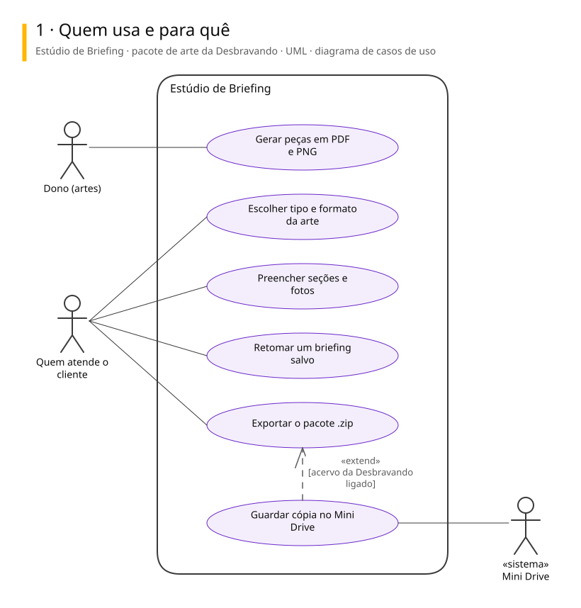
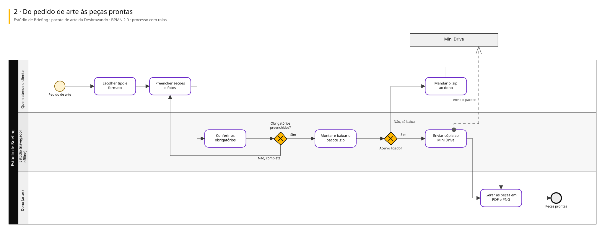
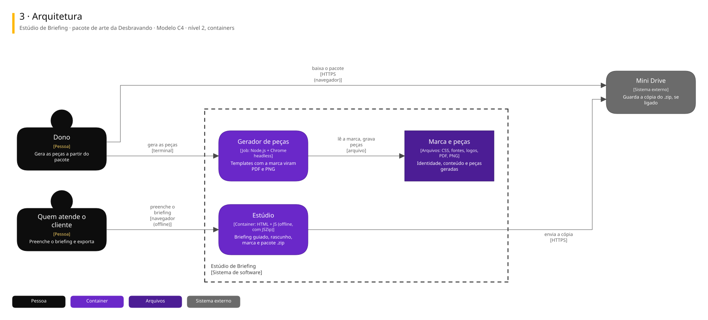

# Arquitetura

Três vistas do sistema, cada uma numa notação padrão.

| Vista | Notação | Responde |
|---|---|---|
| Casos de uso | UML | Quem usa e para quê |
| Processo | BPMN 2.0 | Como o trabalho anda, com uma raia para cada quem executa |
| Arquitetura | C4, nível 2 | De que partes o sistema é feito e com quem conversa |

## Estúdio de Briefing · pacote de arte da Desbravando

Um único HTML que roda offline no navegador: guia o briefing de uma arte da Desbravando UTV seção por seção e gera um .zip com fotos, textos, kit de marca e instruções. Um gerador à parte transforma conteúdo em peças prontas.

### Quem usa e para quê

### Do pedido de arte às peças prontas

### Arquitetura

Para editar: [estudio-de-briefing.excalidraw](./estudio-de-briefing.excalidraw), que abre em [excalidraw.com](https://excalidraw.com) ou na extensão Excalidraw do VS Code.

## De onde vêm

Os diagramas são gerados a partir do Sinapse, o vault onde o Pedro organiza notas e projetos. Mudança feita direto aqui some na próxima publicação: o lugar de mudar é a especificação no Sinapse.
